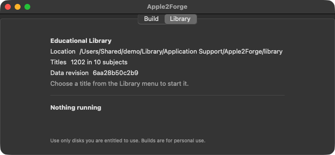
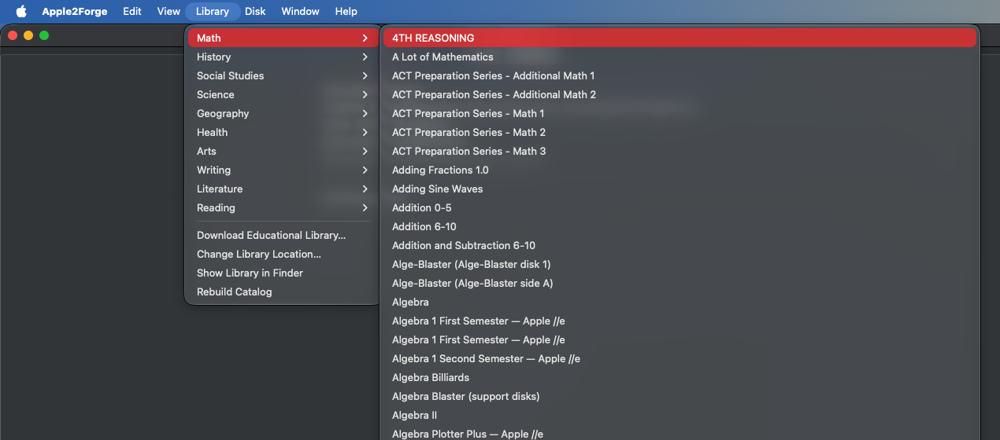
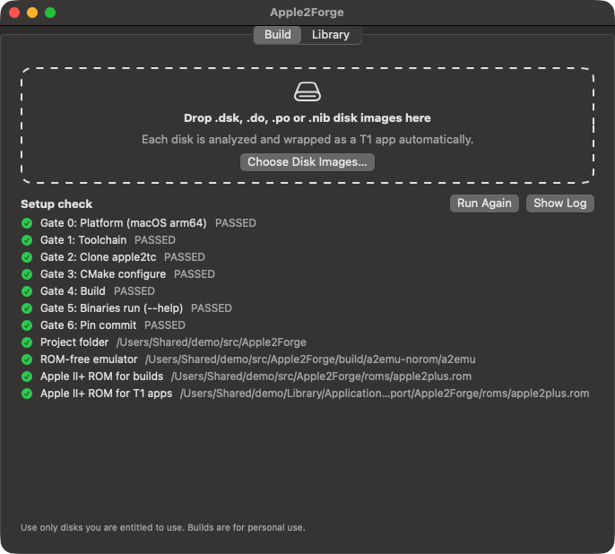
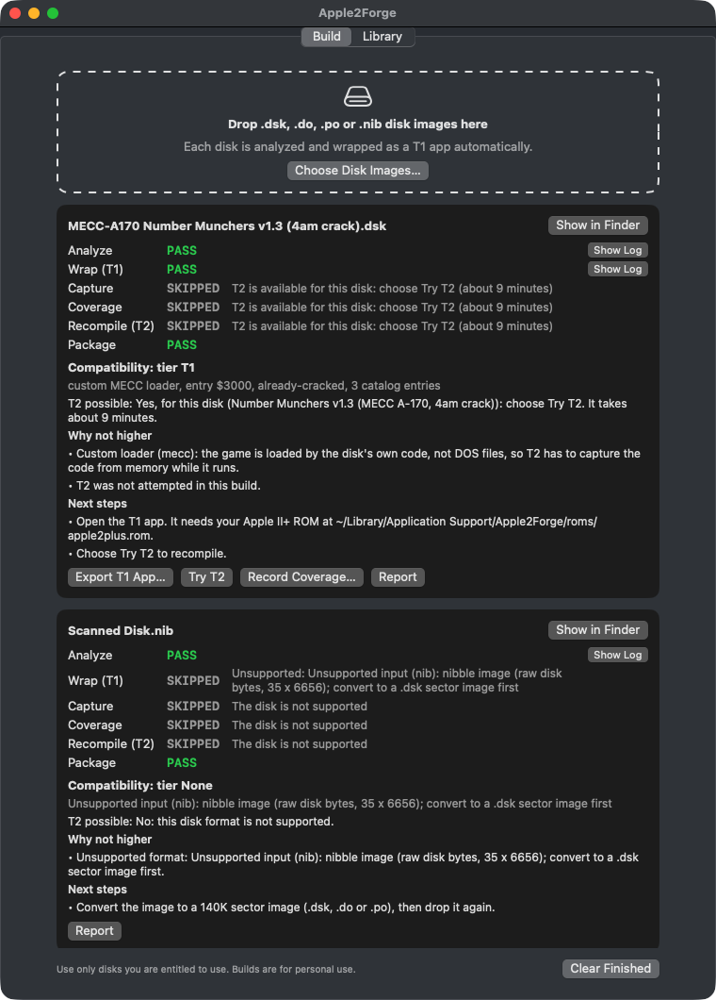
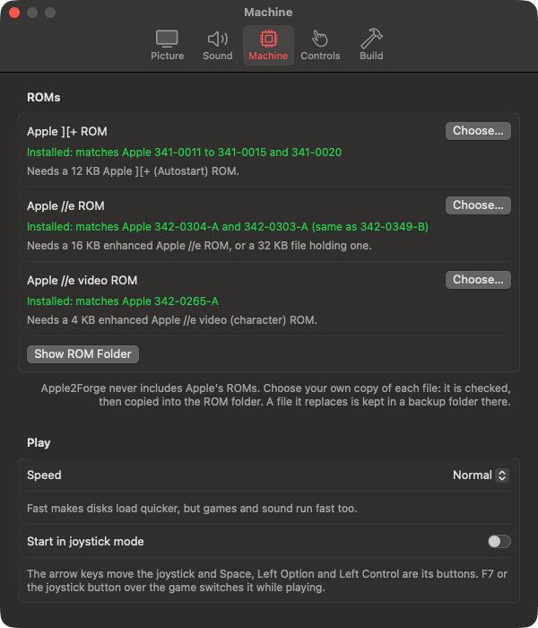

# Apple2Forge

Apple2Forge is the Mac app bundled with this repository. It is a separate, self-contained part of the project, with two tabs:

| Tab | What it does | What it needs |
|---|---|---|
| **Library** | Downloads about 1,200 Apple II educational titles from the [Asimov archive](credits.md#educational-software) and plays them on an emulated Apple ][+ or enhanced Apple //e, with menus for subjects and disk swapping | Only the downloaded app, Python 3 and your Apple II ROMs |
| **Build** | Drag disk images in to turn them into Mac apps with the [native conversion toolkit](native-conversion.md): Analyze, then a T1 app, then a T2-hybrid app where the disk has a profile | A **source checkout** of this repository, set up with `tools/00_setup.sh`, plus your Apple II+ ROM |

The Build tab doesn't contain the toolkit. It runs the scripts in a checkout of this repository, where the toolchain and each disk's working files live. A downloaded `Apple2Forge.app` on its own can use the Library tab, but its Build tab reports "project folder not found" until you point it at a checkout.

The app opens on the **Build** tab. To play the library, choose the **Library** tab, or use the **Library** menu, which works from either tab.

> **No Apple system ROMs or games are included.** The bundled emulator contains two small pieces of Apple-derived firmware data from upstream apple2tc: the Disk II boot PROM and a text font ([notices](../THIRD_PARTY_NOTICES.md#apple-firmware)). Builds made with the Build tab contain the software on your disk: they're for your personal use only.

## Library tab





The Library tab is covered in its own guides:

- [Getting started](getting-started.md): install and first launch.
- [Installing ROMs](installing-roms.md).
- [Educational library](library.md): downloading, location, subjects, which machine each title runs on.
- [Playing games](playing-games.md) and [Disk swapping](disk-swapping.md).

## Build tab

### Set up once

1. Get a source checkout and run the setup, as in [Building from source](building-from-source.md#steps): `tools/00_setup.sh`, `tools/05_fetch_rom.sh --install` and `tools/15_build_a2emu_norom.sh`.
2. Open Apple2Forge, choose **Apple2Forge ▸ Settings…**, and under **Project folder** choose **Choose…**, then select the checkout folder (the one containing `tools/00_setup.sh`).

An app you built yourself with `tools/60_build_app.sh` already knows its checkout, so step 2 isn't needed. The release download doesn't record any folder.



On first launch, and when you choose **Run Again**, the Build tab's **Setup check** runs `tools/00_setup.sh` in the project folder. It lists each toolchain gate, plus the files builds need: the project folder, the ROM-free emulator, the Apple II+ ROM in the checkout's `roms/` folder, and the one in Application Support that T1 apps use. Each missing item names the script that fixes it. The result is remembered once everything passes.

### Build a disk

1. Drop `.dsk`, `.do`, `.po` or `.nib` images on the Build tab, or on the Apple2Forge icon in the Dock or Finder. **Choose Disk Images…** does the same. Other files are refused with a message.
2. Each disk gets a card. Disks build one at a time, through these stages:

   | Stage | Script run in the project folder | When |
   |---|---|---|
   | Analyze | `tools/10_analyze.sh` | Always |
   | Wrap (T1) | `tools/20_wrap_t1.sh` | Always, if Analyze marks the disk supported |
   | Capture | `tools/30_capture.sh` | Only with **Try T2**, for a disk with a T2 profile |
   | Coverage | `tools/40_coverage.sh` (the profile's sessions) | Same |
   | Recompile (T2) | `tools/50_recompile.sh`, then `tools/55_wrap_t2.sh` | Same |
   | Package | Copies the results to the builds folder | Always |

   Each stage shows PASS, FAIL or SKIPPED, with **Show Log**. **Cancel** stops the running build, child processes included.

3. When it finishes, the card shows a compatibility report:
   - the tier reached: T2-hybrid, T1 or None
   - the reasons it isn't higher, such as unsupported format, custom loader, copy protection, no T2 profile or a failed T2 stage
   - whether T2 is possible
   - next steps



The buttons on a finished card:

| Button | Does |
|---|---|
| **Export T1 App…** / **Export T2-hybrid App…** | Copies the app where you choose (`~/Applications` by default) |
| **Try T2** | Runs the T2 stages. Only shown for a disk with a T2 profile; about 9 minutes for Number Munchers |
| **Record Coverage…** | Opens the disk in an emulator window. Play every menu and mode you want covered, then close the window. The keys and the code that ran are saved, and **Report** shows them. **Replay** re-runs the keys from boot and reports whether exactly the same code ran |
| **Report** | Opens `report.md` |
| **Show in Finder** | Shows the disk's builds folder in the Finder |

What to expect:

- **T1 works for any disk Analyze supports**, but whether the disk *boots* depends on the disk. Check the exported app with [`tools/25_check_t1.sh`](make-a-mac-app-from-your-disk.md#4-check-that-it-boots). A T1 app needs your Apple II+ ROM in `~/Library/Application Support/Apple2Forge/roms/` on every Mac that runs it, and has the [limits listed here](make-a-mac-app-from-your-disk.md#what-a-t1-app-is-not).
- **T2-hybrid is offered only for disks in `tools/t2/profiles.json`**, matched by SHA-256. There is one, the Number Munchers v1.3 4am crack. For any other disk the report says "Not automatically" and suggests **Record Coverage…** as the first step towards a profile. See [T2 for another disk](native-conversion.md#t2-for-another-disk).
- **`.nib` images** are analyzed but reported as unsupported, and Wrap (T1) is skipped. Convert them to a 140K `.dsk` first.

### Where builds go

`~/Library/Application Support/Apple2Forge/builds/<disk>/` holds, for each disk:
- the apps
- `analysis.md`
- `report.md` and `report.json`
- the equivalence reports, after a T2 build
- `logs/`
- `recordings/`

Rebuilding moves the previous results into `previous-<time>/`. Intermediate files stay in the checkout's `work/<disk>/` folder.

### Settings

**Apple2Forge ▸ Settings…** has five tabs. Changes to the first four apply the next time a title starts.



| Tab | Shows |
|---|---|
| Picture | **Smooth** (the default: sharp pixels, solid colours) or **Classic** (the softer picture of a colour monitor). See [Playing games](playing-games.md#display-style). |
| Sound | **Play sound**. Off starts games silent; the sound button over the game turns it on. |
| Machine | The Apple ][+, Apple //e and //e video ROMs, each with **Choose…** and **Restore Previous** (see [Installing ROMs](installing-roms.md#option-3-in-settings)); **Speed**, Normal or Fast (5×); and **Start in joystick mode**. |
| Controls | When the [buttons over the game](playing-games.md#buttons-over-the-game) appear: **Show when the mouse moves** (the default), **Always show** or **Hide**. |
| Build | The project folder (**Choose…**, **Show Work Folder**, the pinned apple2tc commit), the ROM the builds use, the builds folder, and the same setup checklist as the Build tab. |

## Command line

The app binary can run a build without a window, which is how the build gate tests it:

```bash
APP=/Applications/Apple2Forge.app/Contents/MacOS/Apple2Forge
"$APP" --project="$HOME/src/Apple2Forge" --build="My Disk.dsk"         # Analyze + T1 + Package
"$APP" --project="$HOME/src/Apple2Forge" --build="My Disk.dsk" --t2    # plus the T2 stages, if profiled
```

It prints each stage's result and the report, then exits: 0 when Analyze and Wrap (T1) pass (and, with `--t2`, the T2 stages too). Without `--project`, a release build prints "the apple2-native project folder was not found". All options: [Command-line tools](command-line-tools.md#apple2forge-command-line-modes).

## How it's tested

`tests/stage6_build_gate.sh` (gates B1–B11) builds the app and runs:
- the Swift unit tests
- a command-line T1 build
- a drop on the app icon with a `.nib` and a text file
- two queued disks
- a recording and its replay
- a first-run setup check
- a full T2 build (about 9 minutes)
- cancelling a build mid-stage

It uses the Number Munchers disks, so it needs your own copy of them. Not automated: an actual mouse drag into the window. The gate sends the same open-file event Finder sends for a drop on the icon.

## Limits

- **The Build tab needs a source checkout**, as described above.
- arm64 (Apple silicon) only. Ad-hoc signed, not notarized: see [first launch](getting-started.md#first-launch).
- T1 apps you build contain the same emulator as Apple2Forge, with its Disk II PROM and font ([notices](../THIRD_PARTY_NOTICES.md#apple-firmware)). The T2-hybrid build's Disk II code has the PROM table zeroed.

## See also

- [Native conversion toolkit](native-conversion.md): the stages and the Number Munchers results.
- [Architecture](architecture.md) and [Signal flow: Build tab](signal-flow.md#build-tab).
- [Troubleshooting: Build tab](troubleshooting.md#build-tab).
