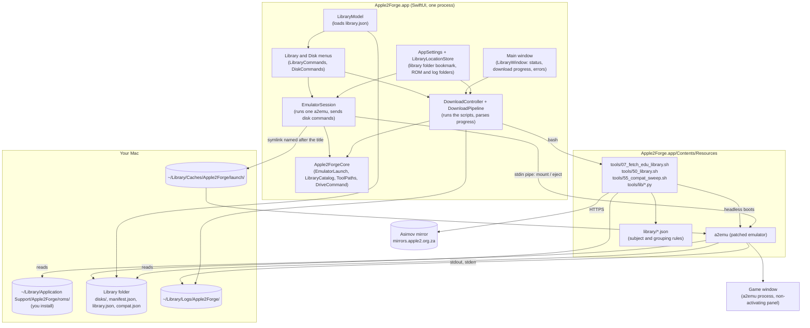

# Architecture

Apple2Forge is two programs working together:

- **Apple2Forge.app**, a SwiftUI app. It owns the menus, the library and settings, and starts games.
- **`a2emu`**, the Apple II emulator from [apple2tc](https://github.com/tmikov/apple2tc), patched by this project. It runs each game in its own window and process.

The library work itself (download, catalog, compatibility check) is done by shell and Python scripts bundled inside the app. The Swift code only runs them and shows their progress.

For step-by-step diagrams of each interaction, see [Signal flow](signal-flow.md).

## Components

## Processes

| Process | Started by | Lifetime | Talks to |
|---|---|---|---|
| Apple2Forge | You | Until you quit | Starts the others |
| `a2emu` (game) | Library menu | Until its window closes, or another title starts | Reads disk commands on standard input; writes `emulator.log` |
| `bash` + `python3` (library scripts) | Download / Rebuild Catalog | One step at a time | Writes JSON progress on standard output, log text on standard error |
| `a2emu --headless` | The compatibility check | About 30 s to 2 min per title | Writes a machine snapshot that the check judges |

Only one game runs at a time. Starting a title stops the running one first.

## Why the game runs in its own process

- **Isolation**: a game that crashes the emulator doesn't take the app with it. Apple2Forge reports the exit code and keeps running.
- **Upstream code unchanged where possible**: `a2emu` is apple2tc's own front end, built on sokol, so this project's changes stay small patches (see [Building from source](building-from-source.md#3-tools15_build_a2emu_noromsh)).
- **Window title**: `a2emu` titles its window with the name it was started as. Apple2Forge therefore starts it through a symlink named after the title, in `~/Library/Caches/Apple2Forge/launch/`.

## Keeping the menu bar

On macOS the menu bar belongs to the active app. A normal window from a second process would make that process active, and `a2emu` has no menus. The game window is therefore a *non-activating panel*: it receives the keyboard, but Apple2Forge stays the active app, so the **Library** and **Disk** menus remain. See [Signal flow: focus and the menu bar](signal-flow.md#focus-and-the-menu-bar).

## Emulated machines

| | Apple ][+ | Enhanced Apple //e |
|---|---|---|
| CPU | 6502 | 65C02 |
| Memory | 48K + 16K Language Card | 128K (main + auxiliary) |
| ROM file | `apple2plus.rom` (12K) | `apple2e-enhanced.rom` (16K) + `apple2e-video.rom` |
| Text | 40 columns, upper case | 40/80 columns, lower case, MouseText |
| Extra keys | — | Open Apple, Solid Apple |
| `a2emu` options | `--rom=…` | `--model=iie --rom=… --video-rom=…` |

Both have a Disk II controller in slot 6 with two drives.

## Source layout

| Path | Contents |
|---|---|
| `app/Apple2Forge/` | Swift package: `Apple2Forge` (UI) and `Apple2ForgeCore` (testable logic), with unit tests |
| `tools/` | Numbered scripts for each stage, plus `tools/lib/` Python modules |
| `library/` | Subject, grouping and override rules for the catalog |
| `vendor/patches/` | Patches applied to apple2tc; `vendor/apple2tc.COMMIT` pins the upstream commit |
| `t2/` | Runtime for recompiled (T2-hybrid) apps |
| `tests/` | Gate scripts per stage, Python unit tests, scripted play sessions |
| `docs/` | This documentation |

Folders created by the scripts, all ignored by Git: `vendor/apple2tc/` (upstream clone), `vendor/apple2tc-norom-src/` (patched export), `build/`, `work/`, `roms/`.

## Design rules

- **No ROMs or disk images in the repository, and no system ROM in the app.** The build checks every byte of the emulator and the app bundle for system-ROM content. The Disk II boot PROM and the Apple ][ text font compiled in from upstream are the known exceptions ([notices](../THIRD_PARTY_NOTICES.md#apple-firmware)).
- **Nothing written inside the app bundle.** The library, ROMs, logs and launch links live in your Library folder.
- **One source of truth for library logic**: the scripts. The app only runs them.
- **Every script stops at the first failed check** and prints a summary, so a half-finished step never looks like success.
