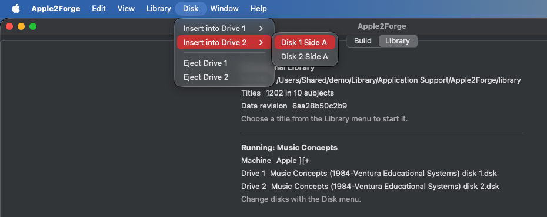

# Disk swapping

Many titles come on more than one disk or disk side. Apple2Forge groups them into a single title and handles the drives for you.

## At start

- Side A (or Disk 1, or the program disk) goes into **drive 1**.
- Side B (or Disk 2, or the data disk) goes into **drive 2**, if the title has one.

Most two-sided titles never ask you to swap, because both sides are already in.

## During play

When a game asks for another disk:

1. Choose **Disk ▸ Insert into Drive 1** (or **Drive 2**).
2. Pick the side the game asked for. The list shows every disk and side of the running title.

The Library tab shows the running title, its machine, and what's in each drive.

**Disk ▸ Eject Drive 1** and **Eject Drive 2** empty a drive; they are greyed out when the drive is already empty. Without a running title, the Disk menu just says *Start a title from the Library menu*.

The swap happens while the game keeps running, as on a real Apple II: the emulator doesn't restart. How the menu reaches the emulator is shown in [Signal flow](signal-flow.md#disk-swap).

## Disk formats

The library uses `.dsk` images. Images in DOS 3.3 order and in ProDOS order (`.po`-style data saved as `.dsk`, common in the MECC collection) are both detected and boot correctly.
