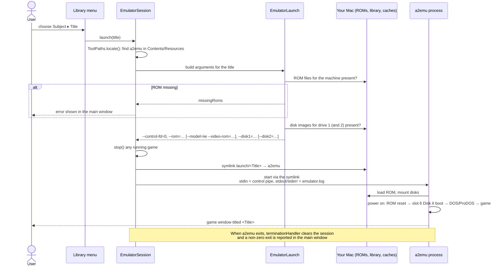
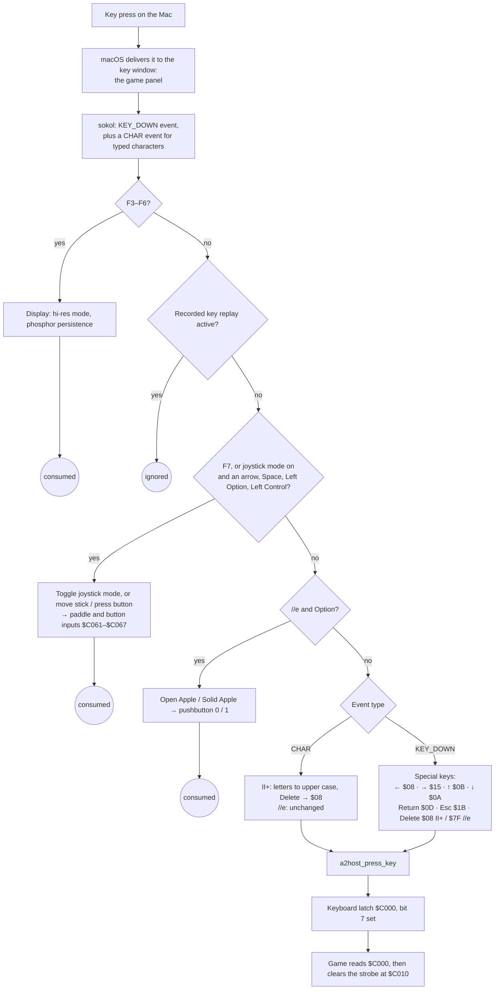
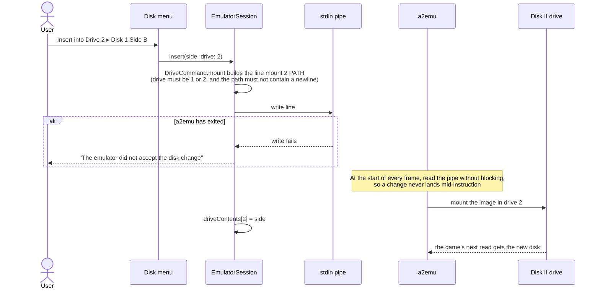
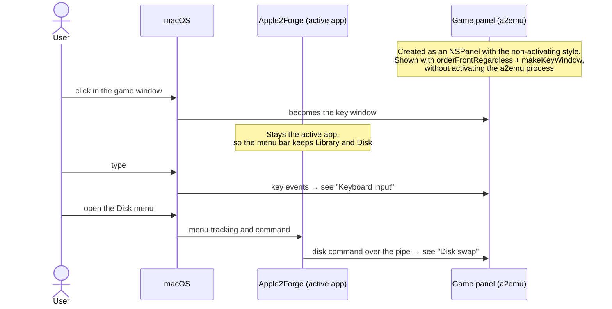
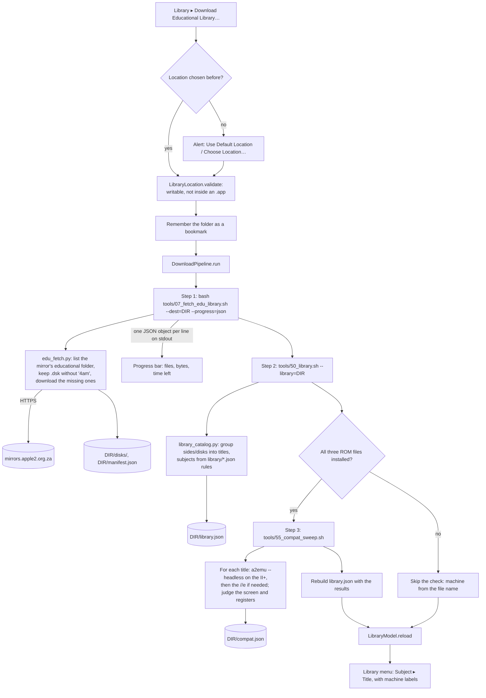
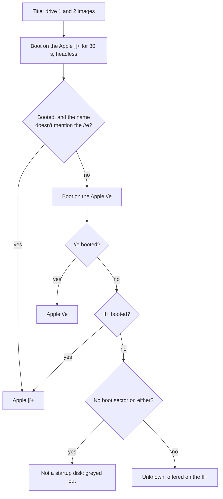
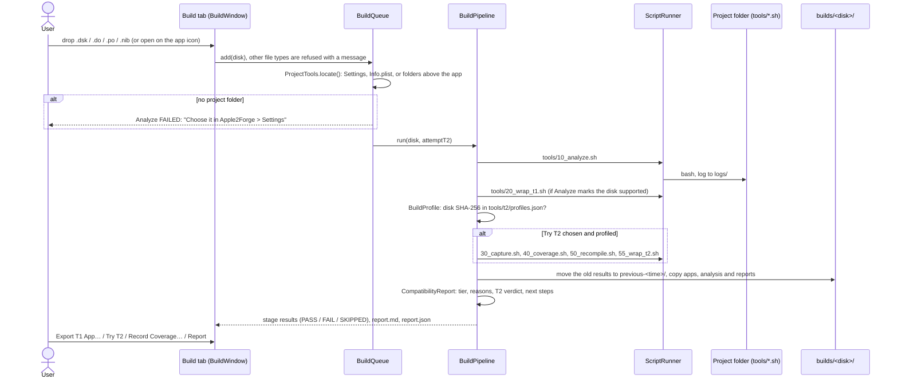
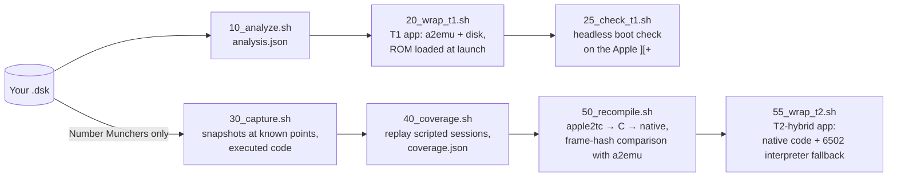

# Signal flow

These diagrams follow each interaction from the click or key press to the emulated Apple II, or from a dropped disk to a built app, using the names in the source code. For the overall structure, see [Architecture](architecture.md).

## Starting a title

## Keyboard input

A key press goes from macOS to the emulator's window, through a chain of handlers, to the Apple II keyboard latch at `$C000`.

The special keys mark their character as already sent, so the CHAR event that follows the same key press doesn't type it twice.

## Disk swap

**Eject** works the same way, with `eject D`.

## Focus and the menu bar

If the game window is brought forward some other way, such as its Dock icon or the app switcher, the `a2emu` process can become the active app. The menu bar then has no Apple2Forge menus until you click the Apple2Forge window.

## Library download, catalog and compatibility check

## Compatibility check: one title

A boot counts as failed if the screen is blank, shows an error or a bare prompt, or the CPU hit an invalid instruction. Blank screens are retried for up to 2 minutes, for slow loaders.

## Build tab

A drop on the Build tab, or on the app icon, runs the [toolkit](native-conversion.md)'s scripts in the project folder, one disk at a time. See [Apple2Forge: Build tab](apple2forge.md#build-tab).

**Cancel**, or quitting the app, stops the running stage script and its child processes, and the report says the stage was cancelled.

## T1 and T2 build stages

These [command-line tools](command-line-tools.md) turn a disk image you own into a Mac app. The Build tab runs the same scripts. T1 accepts any 140K disk the analyzer supports and runs it on an emulated Apple ][+; the app loads your ROM at launch. The T2 path works only for Number Munchers v1.3. See [Make a Mac app from your disk](make-a-mac-app-from-your-disk.md).

Each stage writes to `work/<disk>/` and has a matching gate script in `tests/`. All of these gates assert Number Munchers specifics (its analysis, title screen, code addresses and play sessions), so they pass only for that disk.
